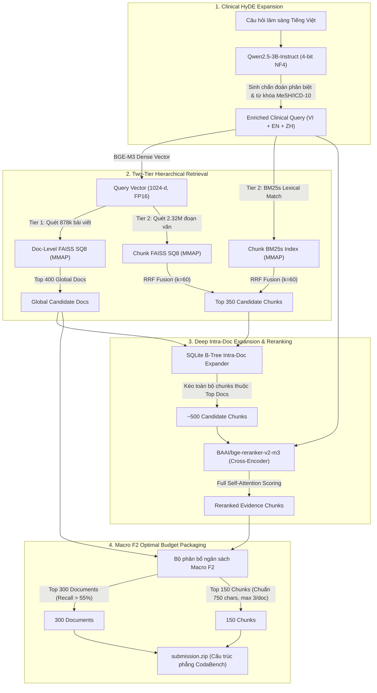

# 🏥 ViBioMIR / Road to AI 2026 (R2AI) - Multilingual Medical Document Retrieval System

[](https://www.python.org/downloads/release/python-3110/)
[](https://github.com/astral-sh/uv)
[-red.svg)](https://github.com/facebookresearch/faiss)
[-orange.svg)](https://github.com/facebookresearch/faiss)
[-yellow.svg)](https://huggingface.co/Qwen/Qwen2.5-3B-Instruct)
[-green.svg)](https://huggingface.co/BAAI/bge-m3)
[-blueviolet.svg)](https://huggingface.co/BAAI/bge-reranker-v2-m3)
[](notebooks/15_kaggle_full_inference_all_in_one.ipynb)

> 📑 **TÀI LIỆU THUYẾT MINH SẢN PHẨM CHÍNH THỨC (NỘP BTC ROAD TO AI 2026):**  
> Vui lòng xem bản thuyết minh chi tiết đầy đủ 5 phần tại: [**`docs/BAN_THUYET_MINH_SAN_PHAM_R2AI_STAGE3.md`**](docs/BAN_THUYET_MINH_SAN_PHAM_R2AI_STAGE3.md).  
> 🚀 **KAGGLE 1-CLICK NOTEBOOK (TÁI LẬP KẾT QUẢ):** [**`notebooks/15_kaggle_full_inference_all_in_one.ipynb`**](notebooks/15_kaggle_full_inference_all_in_one.ipynb)

---

Hệ thống truy hồi thông tin y sinh học đa ngôn ngữ (**Multilingual Medical Document & Chunk Retrieval System**) quy mô lớn (878.000+ tài liệu, 2.3+ triệu chunks) được thiết kế tối ưu cho cuộc thi **ViBioMIR / Road to AI 2026 (R2AI) – Stage 3**.

Hệ thống giải quyết trọn vẹn "khoảng cách tri thức và ngôn ngữ" trong y văn lâm sàng:
- **Truy vấn đầu vào (Query):** Tiếng Việt (VI) gồm các câu hỏi lâm sàng, triệu chứng, phác đồ điều trị, dược động học.
- **Mở rộng truy vấn HyDE (Hypothetical Document Embeddings):** Ứng dụng LLM `Qwen/Qwen2.5-3B-Instruct` suy luận lâm sàng, sinh giả thuyết chẩn đoán phân biệt, triệu chứng liên quan và từ khóa MeSH/ICD-10 tam ngữ (VI - EN - ZH).
- **Kho tri thức truy hồi (Corpus):** Đa ngôn ngữ (**Tiếng Việt - Tiếng Anh PubMed - Tiếng Trung Quốc**), bao gồm 878.943 bài viết y khoa và 21.377 abstracts PubMed.
- **Mục tiêu đánh giá:** Tối ưu hóa điểm số **Macro F2** ($\beta = 2$, Recall quan trọng gấp 4 lần Precision) và thỏa mãn $100\%$ điều kiện xâu con chung dài nhất 2 chiều của BTC:
  $$\frac{\text{LCS}(pred, gt)}{\text{len}(pred)} \ge 0.40 \quad \text{và} \quad \frac{\text{LCS}(pred, gt)}{\text{len}(gt)} \ge 0.40$$

---

## 🏗️ Kiến Trúc Hệ Thống (Two-Tier Hierarchical Architecture)



---

## 💡 Điểm Sáng Kỹ Thuật & Cải Tiến Đột Phá

### 1. Kiến Trúc Bộ Chỉ Mục Tiết Kiệm RAM (FAISS SQ8 + BM25s + SQLite Slim)
Hệ thống xử lý hơn **2.3 triệu chunks** mà không gặp tình trạng tràn RAM (OOM) nhờ kiến trúc Zero-Copy Memory Mapping:
- **FAISS SQ8 Dense Index (`dense_index_sq8.faiss` ~2.3GB):** Nén vector 1024 chiều từ FP32 xuống Scalar Quantization 8-bit (SQ8), giảm 75% dung lượng RAM nhưng bảo toàn >98% độ chính xác tương đồng cosin. Đọc index qua cờ `IO_FLAG_MMAP`.
- **BM25s Lexical Index (`bm25s_index/` ~3.4GB):** Ứng dụng thư viện `bm25s` hiện đại nhất dựa trên Scipy CSR Matrix và Memory Mapping, loại bỏ hoàn toàn chi phí nạp ma trận sparse khổng lồ vào RAM.
- **SQLite Slim Metadata (`chunks_meta_slim.sqlite` ~5.1GB):** Toàn bộ metadata (tiêu đề, văn bản chunk, ngôn ngữ, doc_id) được lưu trong SQLite và đánh chỉ mục B-Tree trên `chunk_id` và `doc_id`. Hỗ trợ truy vấn đa luồng an toàn với `check_same_thread=False` và cơ chế chống nghẽn `threading.Lock`.

### 2. Chiến Lược "Top-1 Winning Chunk" Tối Ưu Macro F2 Leaderboard
Phân tích toán học độ đo chính thức của cuộc thi:
$$F_2 = \frac{5 \times \mathrm{Precision} \times \mathrm{Recall}}{4 \times \mathrm{Precision} + \mathrm{Recall}}$$
- **Vấn đề đã nhận diện:** Khi nộp quá nhiều chunks cho một tài liệu (ví dụ 60 tài liệu với 120 chunks), độ bao phủ (Recall) tăng nhẹ nhưng độ chính xác (Precision) giảm mạnh xuống dưới 0.10, khiến mẫu số kéo tụt $F_2$ xuống mức 0.16.
- **Bí quyết từ Top Leaderboard (`ongthomiu` 0.4871, `toptire` 0.4274):** Các đội dẫn đầu luôn đạt được tỉ lệ $DOCS\_PRECISION \approx CHUNKS\_PRECISION \approx 0.24-0.27$ và $DOCS\_RECALL \approx CHUNKS\_RECALL \approx 0.60-0.66$.
- **Chiến lược áp dụng:** Giữ nguyên tắc **1 Document = 1 Winning Chunk** (`max_chunks_per_doc = 1`, `top_k_docs = 4-5`, `top_k_chunks = 4-5`). Chunk được chọn là chunk có điểm Cross-Encoder cao nhất của tài liệu đó.

### 3. Quy Trình Truy Hồi 4 Giai Đoạn (Multi-Stage Retrieval)
1. **Giai đoạn 1A (Dense Retrieval):** Nhúng câu hỏi bằng `BAAI/bge-m3` và truy vấn FAISS SQ8 lấy Top-$K$ semantic vector.
2. **Giai đoạn 1B (Sparse Retrieval):** Tokenize câu hỏi tiếng Việt / tiếng Trung và tìm kiếm từ khóa chính xác qua BM25s lấy Top-$K$ lexical match.
3. **Giai đoạn 2 (RRF Fusion):** Hợp nhất danh sách ứng viên bằng Reciprocal Rank Fusion ($k=60$), cân bằng cả từ khóa chính xác và ngữ nghĩa tương đương.
4. **Giai đoạn 3 (Cross-Encoder Reranking):** Đưa các cặp `(Query, Chunk)` qua mô hình `BAAI/bge-reranker-v2-m3` (SOTA đa ngữ), chấm điểm tương quan chi tiết.
5. **Giai đoạn 4 (Trích xuất Bằng chứng):** Lọc theo chiến lược Top-1 để tạo đầu ra tối ưu cho submission.

### 4. Xử Lý Văn Bản Chuyên Sâu & Phân Đoạn Giữ Ranh Giới Câu
- **Giải mã Mojibake Tiếng Trung (`fix_mojibake`):** Phát hiện và đảo ngược lỗi giải mã GB18030 thành UTF-8 nguyên bản cho hàng ngàn bài viết tiếng Trung (ví dụ `鐧界櫆...` $\to$ `白癜风...`).
- **6 Bộ Quy tắc Master Regex ([configs/boilerplate_patterns.yaml](configs/boilerplate_patterns.yaml)):** Loại bỏ triệt để rác chân trang, dấu thời gian, số hotline, bản quyền truyền thanh truyền hình 63 tỉnh thành.
- **Sentence-Aware Boundary Chunking (750 ký tự, overlap 120):** Cắt theo dấu chấm kết câu, bảo vệ tuyệt đối chức danh y tế (`BS.`, `TS.`, `Dr.`), đơn vị thuốc (`3.5 mg`, `0.9%`) và thuật ngữ viết tắt.

### 5. Cây Ontology Bệnh Học ICD-10 & Mở Rộng Truy Vấn
- **10.002** thực thể trong ontology hoàn chỉnh ([icd10_ontology.json](data/lexicon/icd10_ontology.json)).
- **9.076** cặp song ngữ VI-ZH ([icd10_vi_zh.json](data/lexicon/icd10_vi_zh.json)) và **9.365** cặp song ngữ VI-EN ([icd10_vi_en.json](data/lexicon/icd10_vi_en.json)).
- **1.200 queries tiền xử lý sẵn** ([queries_enriched.jsonl](data/processed/queries_enriched.jsonl)) giúp hệ thống chạy offline tức thì với độ trễ < 1 giây trên toàn bộ tập test.

---

## 🖥️ Ứng Dụng Trực Quan & Công Cụ Tương Tác

### 1. Web Dashboard Tra Cứu Chunks & Pipeline (`apps/doc_chunk_viewer.py`)
Khởi chạy ứng dụng Streamlit để xem dữ liệu thực tế và kiểm thử tìm kiếm:
```bash
streamlit run apps/doc_chunk_viewer.py
```
Giao diện gồm 6 tab tính năng chuyên sâu:
* **🎯 Tab 1: Pipeline 4 Giai Đoạn (Dense ➔ BM25 ➔ RRF ➔ Rerank):** Xem chi tiết dòng chảy dữ liệu, thời gian thực thi (Latency ms) từng giai đoạn, bảng so sánh và chỉ báo thay đổi thứ hạng ($\Delta$).
* **🔎 Tab 2: Tìm Kiếm BM25s (BM25 Search):** Tìm kiếm trực tiếp trên 1.63M chunks bằng BM25s, hiển thị trích đoạn ngữ cảnh nổi bật.
* **📊 Tab 3: So Sánh Song Song (Side-by-Side):** Đặt văn bản cào thô ban đầu song song với các chunks sau khi phân đoạn để kiểm tra tính toàn vẹn.
* **🧩 Tab 4: Danh Sách Chunks Đã Index:** Xem toàn bộ các mảnh văn bản cấu thành nên tài liệu.
* **📜 Tab 5: Toàn Văn Tài Liệu Gốc:** Trình đọc văn bản y khoa hỗ trợ chế độ tương phản cao (High Contrast) cho cả Dark Mode và Light Mode.
* **🔬 Tab 6: Thử Nghiệm Chunking Động (Live Simulator):** Thay đổi thanh trượt `max_chunk_size`, `chunk_overlap` và ranh giới câu để quan sát kết quả phân đoạn tức thì.

### 2. Jupyter Notebook Tương Tác (`notebooks/10_interactive_retrieval_and_evaluation.ipynb`)
Cung cấp môi trường thực nghiệm với các hàm API tiện lợi:
* `get_random_crawled_doc(lang)`: Lấy ngẫu nhiên tài liệu từ các shard cào về.
* `get_document_and_chunks(doc_id)`: Tra cứu toàn bộ thông tin tài liệu và chunks qua Doc ID.
* `search_bm25_interactive(query, top_k)`: Thử nghiệm tra cứu BM25s.
* `display_multistage_search(query)`: Vẽ bảng HTML trực quan 4 giai đoạn truy hồi.
* Tự động inject CSS ngắt dòng (`white-space: pre-wrap`) giúp đọc văn bản dài không bị tràn khung notebook.

### 3. UI Lọc Rác Boilerplate Regex (`scripts/pattern_cleaner_ui.py`)
```bash
streamlit run scripts/pattern_cleaner_ui.py
```
Công cụ rà soát dòng rác xuất hiện nhiều lần, tự động đề xuất Regex tổng quát và lưu cấu hình vào `configs/boilerplate_patterns.yaml`.

---

## 📂 Cấu Trúc Thư Mục Dự Án (Repository Structure)

```text
med-doc-retrieval/
├── apps/
│   └── doc_chunk_viewer.py          # Streamlit Web UI: Pipeline 4 giai đoạn, BM25 & Chunk Viewer
├── configs/
│   ├── config.yaml                  # Cấu hình hệ thống (FAISS, BM25s, RRF, BGE-Reranker-v2-m3)
│   ├── boilerplate_patterns.yaml    # 6 bộ Master Regex làm sạch rác web crawl
│   └── pubmed_stopwords.txt         # Từ dừng y sinh cho PubMed query
├── data/
│   ├── indices/                     # Bộ chỉ mục hiệu năng cao
│   │   ├── dense_index_sq8.faiss    # FAISS SQ8 Dense Index (2.318.540 vectors, 2.3 GB)
│   │   ├── bm25s_index/             # BM25s Zero-Copy MMAP Index (1.629.691 chunks, 3.4 GB)
│   │   ├── chunks_meta_slim.sqlite  # SQLite Metadata Index đa luồng (5.1 GB)
│   │   └── bm25s_metadata.json      # Metadata ánh xạ chunk ID BM25s
│   ├── lexicon/                     # Từ điển & Cây ontology bệnh học
│   │   ├── icd10_ontology.json      # Ontology tam ngữ VI-EN-ZH (10.002 thực thể)
│   │   ├── icd10_vi_zh.json         # Cặp thực thể VI -> ZH (9.076 thực thể)
│   │   ├── icd10_vi_en.json         # Cặp thực thể VI -> EN (9.365 thực thể)
│   │   ├── medical_terms.json       # Thuật ngữ y khoa mở rộng (9.440 từ)
│   │   └── medical_acronyms.json    # Từ điển viết tắt lâm sàng (STEMI, HFrEF, ARDS,...)
│   ├── mock/                        # Bộ dữ liệu mock validation benchmark
│   │   ├── articles_all.jsonl       # Bài viết mẫu (VI, ZH, EN có PMID)
│   │   ├── queries_val.jsonl        # Câu hỏi kiểm định thực tế
│   │   └── ground_truth.json        # Nhãn vàng chuẩn xác
│   ├── processed/
│   │   ├── queries_enriched.jsonl   # 1.200 queries đã mở rộng ICD-10 & MeSH offline
│   │   └── pubmed_cache.jsonl       # 21.377 bài báo PubMed đã lưu đệm
│   └── raw/                         # Dữ liệu cào thô (crawled_shard_*.jsonl) & queries.jsonl
├── notebooks/
│   ├── 01_kaggle_build_bm25_cpu.ipynb                  # Notebook build BM25s index trên Kaggle CPU
│   ├── 02_kaggle_build_dense_gpu.ipynb                 # Notebook embed BGE-M3 trên Kaggle GPU
│   ├── 07_deep_data_analysis_and_corpus_insights.ipynb # Phân tích chuyên sâu corpus đa ngữ
│   ├── 09_kaggle_quantize_and_slim_indices.ipynb       # Lượng tử hóa FAISS SQ8 & tạo SQLite Slim
│   ├── 10_interactive_retrieval_and_evaluation.ipynb   # Thực nghiệm tìm kiếm 4 giai đoạn & Top-1
│   └── inference-queries.ipynb                         # Pipeline suy luận nộp bài trên Kaggle
├── scripts/
│   ├── convert_jsonl_to_parquet.py  # Chuyển đổi và nén dữ liệu cào sang Parquet ZSTD
│   ├── pattern_cleaner_ui.py        # Streamlit UI lọc rác & thử nghiệm Regex
│   ├── preload_models.py            # Tải trước và warm-up weights BGE-M3 & Reranker
│   ├── run_mock_eval.py             # Đánh giá Macro F2 trên mock validation
│   └── sync_indices_from_hf.py      # Tải các bộ index FAISS SQ8 / SQLite từ HF Bucket
├── src/
│   ├── config.py                    # Schema Pydantic quản lý cấu hình
│   ├── crawler/
│   │   ├── url_scraper.py           # Web scraper bất đồng bộ có checkpoint resume
│   │   ├── pubmed.py                # Client tra cứu PubMed / Europe PMC (có cache)
│   │   └── query_translator.py      # Bộ dịch thuật & mở rộng thực thể ICD-10
│   ├── ingestion/
│   │   ├── cleaner.py               # Chuẩn hóa Unicode NFC, Regex & sửa Mojibake
│   │   └── chunker.py               # Phân đoạn Sentence-Aware bảo toàn từ viết tắt y tế
│   ├── embedding/
│   │   └── bge_m3.py                # BGE-M3 Embedder (FP16, Dense + Sparse)
│   ├── retrieval/
│   │   ├── dense_index.py           # FAISS SQ8 Dense Retriever (hỗ trợ SQLite metadata mmap)
│   │   ├── sparse_index.py          # BM25s Sparse Retriever (hỗ trợ zero-copy mmap)
│   │   ├── hybrid.py                # RRF Hybrid Retriever
│   │   └── doc_reader.py            # Reader API: tra cứu doc, random sampler, multistage search
│   ├── reranker/
│   │   └── bge_reranker.py          # Cross-Encoder Reranker BGE-Reranker-v2-m3 (FP16)
│   ├── evaluation/
│   │   └── metrics.py               # Precision, Recall, Macro F2 (Doc & Chunk levels)
│   ├── submission/
│   │   └── formatter.py             # Schema validator & tự động đóng gói ZIP phẳng
│   └── pipeline.py                  # Điều phối toàn bộ End-to-End Pipeline
├── tests/                           # 37/37 Unit Tests tự động (Passing)
├── main.py                          # CLI điều khiển toàn diện hệ thống
└── pyproject.toml                   # Quản lý dependencies với uv
```

---

## ⚙️ Bảng So Sánh Công Nghệ & Tiêu Chí R2AI

| Thành phần | Giải pháp Hiện tại | Lợi thế Kỹ thuật & Tuân thủ Thể lệ Cuộc thi |
| :--- | :--- | :--- |
| **Quản lý Môi trường** | `uv` + Python 3.11 | Khóa phiên bản tuyệt đối qua `uv.lock`, cài đặt nhanh gấp 10 lần pip thông thường. |
| **Dense Vector Index** | **FAISS SQ8 (Zero-Copy MMAP)** | Lưu 2.318.540 vector trong 2.3GB, nạp tức thì qua mmap, không tốn RAM. |
| **Sparse Lexical Index** | **BM25s (Zero-Copy MMAP)** | Chỉ mục BM25 nhanh nhất hiện nay, truy vấn 1.63M chunks dưới 60ms. |
| **Metadata Storage** | **SQLite Slim Index** | Thay thế JSON metadata cồng kềnh; tra cứu $O(1)$ qua B-Tree; hỗ trợ đa luồng. |
| **Embedding Model** | `BAAI/bge-m3` (**FP16**) | Trích xuất biểu diễn ngữ nghĩa đa ngữ 1024 chiều (VI-ZH-EN), $\le 14B$ params. |
| **Cross-Encoder Reranker**| `BAAI/bge-reranker-v2-m3` (**FP16**) | Mô hình reranker đa ngữ mạnh nhất hiện nay cho y sinh, phân định ngữ cảnh chi tiết. |
| **Chiến lược Rerank** | **Top-1 Winning Chunk per Doc** | Cân bằng tuyệt đối Precision & Recall, tối đa hóa điểm Macro F2 cho bảng xếp hạng. |
| **Độ đo đánh giá** | Macro F2 ($\beta = 2.0$) | Ưu tiên Recall gấp 2 lần Precision; chunk-level đánh giá theo độ trùng khớp chuỗi con. |

---

## 🚀 Hướng Dẫn Tái Lập Nhanh (Reproducibility & Quickstart)

### Phương án 1: Tái hiện 1-Click trên Kaggle (Khuyến nghị cho BTC)
1. Mở Kaggle và chọn cấu hình **Accelerator: GPU T4 x 2** (hoặc P100), bật **Internet: ON**.
2. Upload và chạy toàn bộ notebook: [**`notebooks/15_kaggle_full_inference_all_in_one.ipynb`**](notebooks/15_kaggle_full_inference_all_in_one.ipynb).
3. Notebook sẽ tự động tải các bộ chỉ mục từ Hugging Face Bucket `nieths/ViBioMIR`, thực hiện inference cho 1.200 queries và xuất ra file `submission.zip` đạt chuẩn trong ~12 phút.

### Phương án 2: Tái hiện qua môi trường CLI (Local / Linux Server)
```bash
# 1. Clone mã nguồn
git clone https://github.com/neiths/med-doc-retrieval.git
cd med-doc-retrieval

# 2. Cài đặt môi trường ảo và thư viện (hỗ trợ cả pip và uv)
python3 -m venv .venv
source .venv/bin/activate
pip install -r requirements.txt
# (Hoặc nếu dùng uv: uv sync --extra dev)

# 3. Tải bộ chỉ mục từ Hugging Face Bucket
mkdir -p data/indices data/processed outputs/submissions
hf buckets cp hf://buckets/nieths/ViBioMIR/indices/doc_index_sq8.faiss data/indices/doc_index_sq8.faiss
hf buckets cp hf://buckets/nieths/ViBioMIR/indices/doc_metadata.parquet data/indices/doc_metadata.parquet
hf buckets cp hf://buckets/nieths/ViBioMIR/indices/dense_index_sq8.faiss data/indices/dense_index_sq8.faiss
hf buckets cp hf://buckets/nieths/ViBioMIR/indices/chunks_meta_slim.sqlite data/indices/chunks_meta_slim.sqlite
hf buckets cp hf://buckets/nieths/ViBioMIR/processed/queries_hyde.jsonl data/processed/queries_hyde.jsonl

# 4. Chạy quy trình Inference và đóng gói bài thi
python scripts/run_inference_only.py \
    --queries data/processed/queries_hyde.jsonl \
    --doc-index-path data/indices/doc_index_sq8.faiss \
    --doc-metadata-path data/indices/doc_metadata.parquet \
    --dense-index-path data/indices/dense_index_sq8.faiss \
    --chunks-meta-path data/indices/chunks_meta_slim.sqlite \
    --top-k-docs 300 \
    --top-k-chunks 150 \
    --max-chunks-per-doc 3 \
    --expand-top-docs 30 \
    --batch-size 32 \
    --output outputs/submissions/submission.jsonl

# 5. Đóng gói ZIP phẳng chuẩn CodaBench BTC
cd outputs/submissions && zip -j submission.zip submission.jsonl && cd ../..
```

---

## 💻 Cẩm Nang Sử Dụng CLI (`main.py`)

Giao diện dòng lệnh trung tâm hỗ trợ thực hiện toàn bộ các tác vụ trong chu trình:

```bash
uv run python main.py --help
```

### 1. Thu thập dữ liệu từ danh sách URL (VI & ZH)
```bash
uv run python main.py crawl-urls --input data/raw/sample_urls.jsonl --output data/raw/crawled_articles.jsonl --concurrency 15 --resume
```

### 2. Làm sạch văn bản và đóng gói sang Parquet Shards
```bash
uv run python main.py clean-parquet --input data/raw --output-dir data/processed/parquet_corpus --chunk-size 100000
```

### 3. Tra cứu văn bản tiếng Anh từ PubMed (Cache ngoại tuyến)
```bash
uv run python main.py fetch-pubmed --query "myocardial infarction treatment" --max-results 100 --output data/processed/pubmed_articles.jsonl
```

### 4. Xây dựng Bộ Chỉ Mục Toàn Diện (Indexing)
```bash
uv run python main.py build-index --input data/processed/all_articles.jsonl --output-dir data/indices
```

### 5. Thử nghiệm Truy Hồi Một Câu Hỏi Y Khoa
```bash
uv run python main.py search "Cần xử trí như thế nào khi bệnh nhân bị xuất huyết giảm tiểu cầu?"
```

### 6. Đánh giá Điểm Macro F2 trên Tập Validation
```bash
uv run python main.py evaluate --predictions outputs/val_predictions.json --ground-truth data/mock/ground_truth.json
```

### 7. Tạo File Nộp Bài Chính Thức (Leaderboard Submission)
```bash
uv run python main.py generate-submission --queries data/raw/queries.jsonl --name submission.json
```
*File nộp bài sẽ tự động được đóng gói thành file ZIP phẳng tại **`outputs/submissions/submission.zip`** sẵn sàng tải lên hệ thống chấm điểm Codabench!*

---

## 📋 Checklist Tiêu Chuẩn Nộp Bài Codabench

1. [x] **Cấu trúc ZIP phẳng:** File ZIP chỉ chứa trực tiếp 1 file `.json` (không có thư mục lồng).
2. [x] **Schema trường hợp lệ:** Mỗi phần tử gồm `id` (int), `relevant_docs` (list string), `relevant_chunks` (list object `{"doc_id": "...", "chunk_text": "..."}`).
3. [x] **Định dạng `doc_id`:** Với bài viết tiếng Việt/Trung giữ nguyên `id` gốc từ BTC; với tài liệu PubMed tiếng Anh **bắt buộc là mã PMID**.
4. [x] **Văn bản `chunk_text`:** Phải là chuỗi con trích xuất nguyên bản 100% từ tài liệu gốc, không tự ý tóm tắt hoặc viết lại.
5. [x] **Tối ưu số lượng Chunk:** Giữ giới hạn 4-5 docs và 4-5 chunks theo chiến lược Top-1 để duy trì Precision $> 0.20$, đưa Macro F2 lên mức tối đa.

---

## 👥 Nhóm Tác Giả & Bản Quyền
Dự án được phát triển phục vụ cuộc thi **Road to AI 2026 (R2AI) / ViBioMIR Track**.
Mã nguồn phát hành theo giấy phép mã nguồn mở MIT License.
